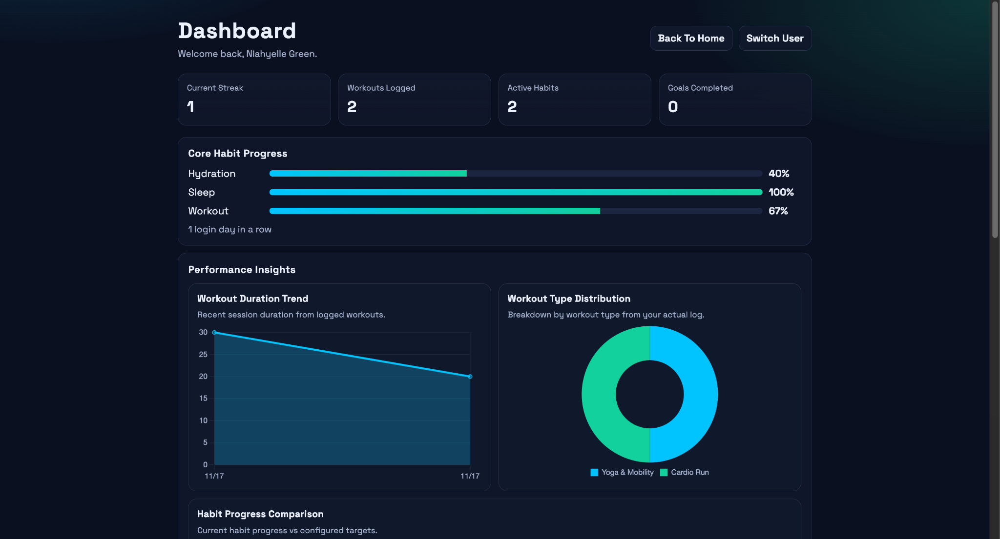
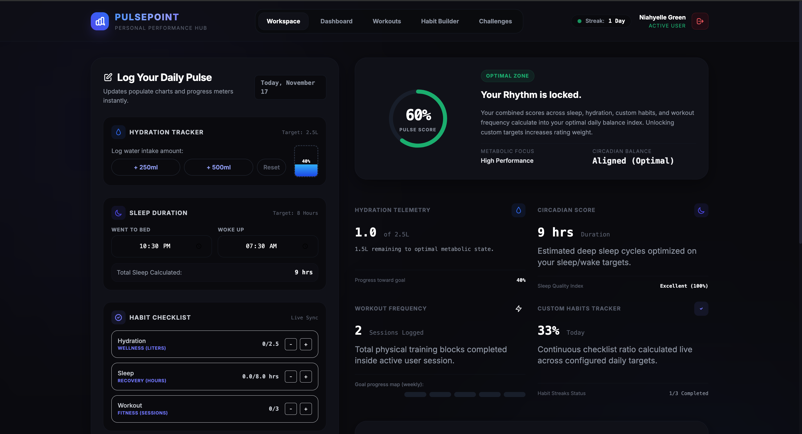
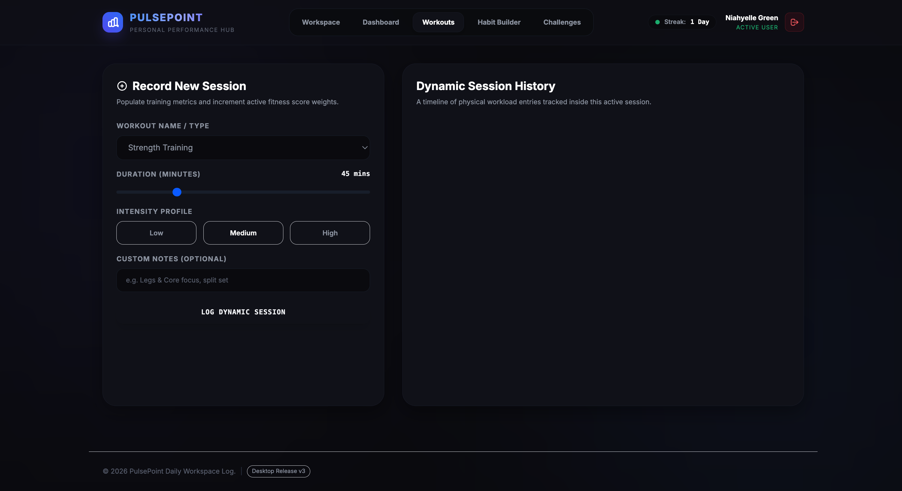
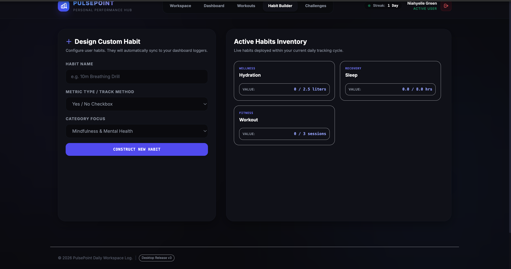

# PulsePoint

A fitness and wellness web application for logging workouts, tracking hydration and sleep, building habits, and viewing personal progress.

**Class project → personal portfolio fork.** PulsePoint began as a six-person Scrum project. This fork is maintained by **Niahyelle Green**, an original team contributor, and extends the shared application with authentication, user-data access controls, regression tests, and troubleshooting documentation. The original application is team work; individual contributions and later improvements are distinguished below.

[Preview](#screenshots) · [Features](#features) · [Local setup](#local-setup) · [Tests](#tests) · [Contributions](#contributions-and-team-credit)

## Screenshots

### Dashboard

Summary cards, core-habit progress, workout duration trends, and workout-type distribution.



<details>
<summary><strong>Daily workspace</strong> — hydration, sleep, and habit tracking</summary>

The workspace brings daily inputs and progress indicators together.



</details>

<details>
<summary><strong>Workout logging</strong> — session entry and history</summary>

Workout entry form with type, duration, intensity selection, and optional notes. This capture shows the history panel before entries are displayed.



</details>

<details>
<summary><strong>Habit builder</strong> — custom habits and tracking targets</summary>

Habit configuration alongside hydration, sleep, and workout targets.



</details>

Screenshots were supplied by the maintainer and show different application states; they are interface previews, not automated verification. Pulse scores and wellness labels are application-defined indicators, not clinical measurements or validated health assessments.

## Features

- Account registration, login, logout, and user profiles.
- Workout creation, viewing, editing, and deletion through the API.
- Hydration, sleep, and custom-habit tracking.
- Personal dashboard with progress summaries and workout visualizations.
- Goals, login streaks, and challenge workflows.
- Session-based access controls for personal records.

## Technology

| Area | Tools |
| --- | --- |
| Backend | Python, FastAPI, Uvicorn |
| Database | MySQL, SQLAlchemy, PyMySQL |
| Validation | Pydantic |
| Frontend | HTML, CSS, JavaScript, Tailwind CSS, Chart.js |
| Authentication | Argon2id password hashing, server-side cookie sessions |
| Testing | Python unittest, FastAPI TestClient, temporary SQLite, headless Chrome rendering checks |

## Local setup

No paid hosting or renewed domain is needed to run locally.

**Prerequisites:** Python 3.11 or newer, a running local MySQL server, and Git. The documented local verification used Python 3.13. Run commands from the repository root.

### 1. Get the project and install dependencies

```bash
git clone https://github.com/ngreen39/PulsePoint.git
cd PulsePoint
python3 -m venv .venv
source .venv/bin/activate
python -m pip install -r requirements.txt
```

On Windows, activate with `.venv\Scripts\activate` instead.

### 2. Configure local settings

```bash
cp .env.example .env
```

On Windows, copy the file using your editor or `Copy-Item .env.example .env` in PowerShell.

Edit the **.env text file** with your local MySQL settings:

```dotenv
DB_HOST=localhost
DB_PORT=3306
DB_USER=your_local_mysql_user
DB_PASSWORD=your_local_mysql_password
DB_NAME=pulsepoint
```

`.venv/` contains installed libraries. `.env` contains private settings. Both stay out of Git; `.env.example` contains placeholders and belongs in the repository.

### 3. Create the database

Sign in with your existing local MySQL account:

```bash
mysql -u YOUR_MYSQL_USER -p
```

Then run:

```sql
CREATE DATABASE IF NOT EXISTS pulsepoint
  CHARACTER SET utf8mb4
  COLLATE utf8mb4_unicode_ci;
EXIT;
```

The configured user needs permission to create and update tables in that database. Startup creates mapped tables and applies the existing additive schema updates. See [authentication and migration notes](docs/authentication.md) before upgrading an existing database.

### 4. Start the application

```bash
python -m uvicorn main:app --host 127.0.0.1 --port 8000 --reload
```

- Application: http://127.0.0.1:8000/
- Interactive API documentation: http://127.0.0.1:8000/docs

Create a test account, sign in, and log a workout or habit. Use the same hostname throughout a session: cookies for `localhost` and `127.0.0.1` are separate.

The former class-project domain is no longer maintained; use these local URLs.

## Authentication and API behavior

- New and changed passwords are hashed with Argon2id.
- Login uses an HttpOnly, SameSite=Strict session cookie; the database stores a digest of the session token.
- Logout invalidates the presenting session, and password changes revoke the account's sessions.
- Personal APIs require authentication and enforce record ownership.
- Mutating API calls require `X-PulsePoint-Request: 1`; the frontend supplies it and Swagger exposes it.
- Legacy plaintext accounts upgrade after a successful login. Accounts that have not migrated still retain legacy storage; see the documented transition limitations.

Read the [implementation notes](docs/authentication.md) and [verification record](docs/authentication-verification.md) for details.

## Tests

```bash
python -m pip install -r requirements-dev.txt
python -m unittest discover -s tests -v
```

API tests use a temporary SQLite database and block connections to the configured MySQL engine. They do not reset your local application database.

The saved-text rendering test uses an installed Chrome browser. See the test runner for browser discovery requirements. The app server is not required for this suite.

Covered scenarios include signup and login validation, session expiry and revocation, cross-user access denial, legacy-password migration, response secrecy, API request-protection metadata, and safe rendering of saved habit/workout text. The latest checked-in verification record reports **19 passing tests**; see [review fixes](docs/review-fixes.md). This is not a claim of complete application coverage.

## Architecture and repository guide

The browser loads static pages from FastAPI and calls same-origin API routes. Routers authenticate requests and enforce ownership; controllers coordinate feature logic; SQLAlchemy persists mapped records in MySQL.

| Path | Purpose |
| --- | --- |
| `main.py` | Application, static-page routing, request protection, schema initialization |
| `routers/` | Feature endpoints and access checks |
| `controllers/` | Workout, habit, goal, challenge, profile, and dashboard logic |
| `models/` | SQLAlchemy models and the current goal data structure |
| `schemas/` | Request validation and response schemas |
| `dependencies/` | Configuration, database sessions, authentication, schema upgrades |
| `frontend/` | HTML pages, styles, and JavaScript |
| `tests/` | API regressions and browser rendering checks |
| `docs/` | Investigation records, authentication notes, screenshots |
| `DESIGN.md`, `UML.pdf` | Class-project design documentation |

## Contributions and team credit

### Niahyelle Green — original class-project contributions

- Established initial repository scaffolding and contributed setup documentation.
- Developed the dashboard frontend and client-side logic.
- Contributed landing-page layouts and account-creation interfaces.
- Fixed signup validation, workout persistence, and daily habit-checklist behavior.
- Improved input readability, contrast, and hydration-icon rendering.

Selected original commits retained in this fork's history:

| Work | Commit |
| --- | --- |
| Initial project skeleton | [0de777f](https://github.com/ngreen39/PulsePoint/commit/0de777f) |
| Dashboard frontend and logic | [71c1e7f](https://github.com/ngreen39/PulsePoint/commit/71c1e7f) |
| Workout persistence fix | [3f64b16](https://github.com/ngreen39/PulsePoint/commit/3f64b16) |
| Habit checklist fix | [d1147ca](https://github.com/ngreen39/PulsePoint/commit/d1147ca) |

These contributions do not imply sole authorship of the application or every backend feature.

### Subsequent work in this portfolio fork

The fork adds environment-based configuration, same-origin frontend requests, Argon2id hashing, authenticated sessions, ownership checks, safe saved-text rendering, API protection-header documentation, and regression tests. Investigation and implementation records are linked below. These changes build on the team's application and are separate from the original class contributions.

### Original project team

| Member | Original Scrum role |
| --- | --- |
| Sean Enohmbi | Product Owner |
| Jennifer Vazquez | Scrum Master |
| Ananya Patchigolla | Developer |
| Niahyelle Green (listed as “Niahya Green” in the original README) | Developer |
| Diya Patel | Developer |
| Mohamed Shire | Developer |

The class team owns credit for the shared project foundation. This repository preserves that history and documents the maintainer's continued development.

## Engineering notes and current limits

- [Baseline investigation](docs/baseline.md): distinguishes frontend-origin failures from database persistence behavior.
- [Authentication design](docs/authentication.md): sessions, ownership, and the legacy-account transition.
- [Authentication verification](docs/authentication-verification.md): documented browser and API results.
- [Review fixes](docs/review-fixes.md): saved-text rendering and interactive API documentation.

Current limitations:

- Goals use process memory and do not survive server restarts.
- Broader daily-rollover, transaction-failure, and restart-persistence coverage remains future work.
- Frontend styling/chart assets include external CDN dependencies.
- Desktop screenshots do not establish mobile or accessibility conformance.
- This is a learning and portfolio application; use fictional data for demonstrations.
